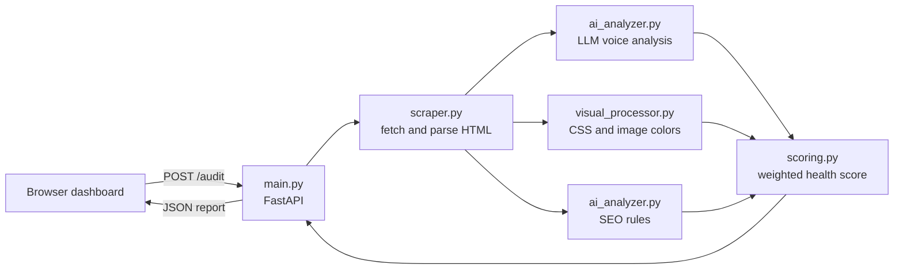

# Brand Voice & Visual Style Auditor


A full-stack web app that audits a brand's website. Enter a URL, optionally add your brand guidelines, and get a **Brand Health Score** out of 100 with a breakdown of voice, SEO and color cohesion, plus a short list of what to fix first.


## Try it in 30 seconds (no API key)

```bash
git clone https://github.com/lelentandane/brand-voice-auditor.git
cd brand-voice-auditor
python -m venv venv && source venv/bin/activate   # Windows: venv\Scripts\activate
pip install -r requirements.txt
cd backend && uvicorn main:app --reload
```

Open **http://localhost:8000** and select **View a sample audit**. The sample is a finished report for a fictional coffee brand and needs no key and no network. Live audits of real sites need an Anthropic API key (see Getting started).

## Features

- **Page scraping:** extracts title, meta description, headings, body copy, images and stylesheets.
- **SEO audit:** deterministic checks for title and meta length, H1 usage, subheadings, word count and keyword placement.
- **Brand voice analysis:** an LLM scores tone and consistency against a fixed rubric and, when provided, your own brand guidelines. Every issue is backed by a quote from the page and a suggested fix.
- **Color palette extraction:** reads brand colors from the site's CSS (design tokens weighted highest) and from page images with ColorThief, then merges near-identical shades.
- **Unified report:** a weighted overall score with a per-component breakdown.
- **Fix these first:** the most important voice issues and failed SEO checks, each with a concrete action.
- **Built-in sample audit:** explore a complete report without any API key.

## Tech stack

| Layer | Tools |
|---|---|
| Backend | Python 3.10+, FastAPI, Uvicorn, Pydantic |
| Scraping | requests, BeautifulSoup4 |
| AI | Anthropic Claude API (structured output via forced tool use) |
| Vision | Pillow, ColorThief, CSS color parsing |
| Frontend | HTML, CSS, vanilla JavaScript |

## Architecture



Voice analysis and visual analysis run in parallel, since both spend most of their time waiting on the network.

### Design decisions

- **SEO is plain code, not an LLM.** Rules like title length and H1 count are objective, so scoring them in code makes results reproducible and free.
- **The LLM handles only what needs judgment.** Voice is scored against a fixed rubric, and the model returns structured output through a tool schema instead of free-form JSON.
- **Brand colors come from CSS first.** Photos rarely contain brand colors, so CSS (especially custom properties like `--brand`) is weighted 70% and images 30%.
- **Unmeasurable components are left out, not scored as zero.** Remaining weights are renormalized.
- **Partial failures degrade gracefully.** If visual analysis fails, the audit still returns voice and SEO results with a warning.

### Scoring

| Component | Weight | Method |
|---|---|---|
| Brand voice | 50% | LLM with a fixed rubric, judged against your guidelines when provided |
| SEO | 30% | Share of deterministic checks passed |
| Visual cohesion | 20% | Palette heuristic based on the number of hue families |

Weights and thresholds are heuristic defaults defined in `scoring.py`.

## Project structure

```
brand-voice-auditor/
├── backend/
│   ├── main.py              # FastAPI app and /audit endpoint
│   ├── scraper.py           # Fetching, parsing, URL safety checks
│   ├── ai_analyzer.py       # SEO rules and LLM voice analysis
│   ├── visual_processor.py  # CSS and image color extraction
│   ├── scoring.py           # Visual score, overall health score, priority fixes
│   └── sample_data.py       # Example report for demo mode
├── frontend/
│   ├── index.html           # Dashboard layout
│   ├── style.css            # Styling, light and dark themes
│   ├── script.js            # Form handling and safe DOM rendering
│   └── fonts/               # Bundled Hanken Grotesk and Instrument Serif (OFL)
├── tests/                   # pytest suite
├── docs/screenshots/
├── requirements.txt
├── requirements-dev.txt
└── README.md
```

## Getting started

### Prerequisites

- Python 3.10 or newer
- An [Anthropic API key](https://console.anthropic.com/)

### Setup

```bash
git clone https://github.com/lelentandane/brand-voice-auditor.git
cd brand-voice-auditor

python -m venv venv
source venv/bin/activate        # Windows: venv\Scripts\activate

pip install -r requirements.txt

export ANTHROPIC_API_KEY="your-key-here"   # Windows (PowerShell): $env:ANTHROPIC_API_KEY="your-key-here"
```

### Run

```bash
cd backend
uvicorn main:app --reload
```

Open **http://localhost:8000**. The backend serves the dashboard, so no separate frontend server or CORS setup is needed.

### Configuration

| Variable | Required | Default | Purpose |
|---|---|---|---|
| `ANTHROPIC_API_KEY` | Yes | none | API key for the voice analysis |
| `ANTHROPIC_MODEL` | No | `claude-sonnet-5-5` | Override the model used |
| `RATE_LIMIT_PER_HOUR` | No | `20` | Audits allowed per IP address per hour |

## API

### Endpoints

| Endpoint | Method | Purpose |
|---|---|---|
| `/audit` | POST | Run a live audit |
| `/api/sample` | GET | Example report, flagged `is_sample: true`. No key needed |
| `/api/status` | GET | Whether the server has an API key configured |

### `POST /audit`

```bash
curl -X POST http://localhost:8000/audit \
  -H "Content-Type: application/json" \
  -d '{
    "url": "example.com",
    "brand_tone": "warm, playful, premium",
    "keywords": ["specialty coffee", "small batch"],
    "guidelines": "Short sentences. Friendly, never salesy."
  }'
```

Only `url` is required. Without guidelines, the voice check scores consistency only and `guideline_adherence_score` is `null`.

**Response (abridged):**

```json
{
  "url": "https://example.com/",
  "page": { "title": "...", "word_count": 420, "image_count": 6 },
  "brand_health": {
    "overall": 82,
    "components": { "voice": 78, "seo": 100, "visual": 80 },
    "weights": { "voice": 0.5, "seo": 0.3, "visual": 0.2 }
  },
  "voice": {
    "detected_tone": "warm",
    "consistency_score": 80,
    "guideline_adherence_score": 75,
    "summary": "...",
    "strengths": ["..."],
    "issues": [{ "issue": "...", "evidence": "...", "fix": "..." }]
  },
  "seo": { "score": 83, "checks": [{ "check": "...", "passed": true, "detail": "..." }] },
  "visual": {
    "brand_palette": [{ "hex": "#6c3be0", "sources": ["css", "image"] }],
    "neutrals": [{ "hex": "#111111", "weight": 4 }],
    "metrics": { "palette_size": 3, "hue_families": 2 }
  },
  "warnings": []
}
```

**Status codes:** `200` success, `400` invalid or blocked URL, `422` invalid input or no readable text, `429` rate limit reached, `502` AI service error, `503` no API key configured.

## Tests

```bash
pip install -r requirements-dev.txt
pytest
```

The suite covers scoring and score rescaling, every SEO rule, URL safety checks, HTML parsing, CSS color extraction and the API endpoints (with the network and AI calls replaced by fakes). It runs on every push through GitHub Actions.

## Security

- **SSRF protection:** because the server fetches user-supplied URLs, it allows only public `http(s)` addresses. It resolves the hostname, rejects private, loopback, link-local and reserved IPs, and re-checks the final address after redirects.
- **Resource limits:** pages, stylesheets and images have byte caps and request timeouts, and image dimensions are capped to guard against decompression bombs.
- **Prompt injection:** scraped text is treated as untrusted data. It is delimited in the prompt and the model is instructed to analyze it, never follow it.
- **XSS:** report text comes from third-party sites and an LLM, so the frontend inserts it with `textContent` and never `innerHTML`.

## Limitations and scope

**Scraping**
- The scraper uses `requests` and BeautifulSoup, so content rendered client-side by JavaScript is not captured. The API returns a clear error when a page has no readable text.
- Audits cover the submitted page only, not site-wide consistency.
- Sites that block automated requests may fail to load, and `robots.txt` is not consulted.

**Scoring**
- Weights, thresholds and the visual cohesion heuristic are defaults, not calibrated values. Scores are best read as guidance and for comparing revisions of the same site.
- LLM-based voice scores can vary by a few points between runs.
- The visual score treats fewer hue families as more cohesive, which understates intentionally colorful brands.

**Color extraction**
- Named CSS colors (such as `red`), colors set through JavaScript, and inline `style` attributes are not detected.
- Utility frameworks like Tailwind include many unused color classes, which can add noise to the palette.

**Deployment**
- The built-in rate limiter is per process and resets on restart. A public deployment should add result caching and a proxy-aware limiter to protect API usage.
- The SSRF check resolves DNS before fetching. Production use should pin the resolved IP for the request to rule out DNS rebinding.
- SEO rules and the voice rubric assume English-language copy.

## Roadmap

- [ ] Playwright fallback for JavaScript-rendered sites
- [x] Per-IP rate limiting
- [ ] Short-lived result cache
- [x] Automated tests (pytest) for parsers, scoring and the API
- [ ] Multi-page crawl for site-wide voice consistency
- [ ] Vision model review of a homepage screenshot
- [ ] Calibrate scoring against a labeled set of sites
- [ ] PDF export of the report
- [ ] Docker setup

## License

MIT. See `LICENSE`.

## Author

**Sphelele Ntandane**
[GitHub](https://github.com/lelentandane) | [LinkedIn](https://www.linkedin.com/in/lelentandane)
